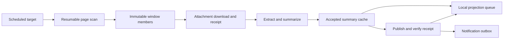

# Durable task runtime (schema 5)

The production `tick`, `run-stage`, and `outbox drain` commands now call the
supervisor in `service.py`. `worker.py` retains synchronous adapters for offline
maintenance and existing integration fixtures; production does not enter its
window loop.

## Why previous recovery did not close the incident

A successful source scan was repeated whenever any old attachment remained
unsettled. Terminal staging collisions therefore held the source checkpoint
back while hundreds of successful scans rediscovered the same debt. Window
errors also had states the old selector never selected. Notifications were
keyed by window, so a recurring source outage produced a new alert for each
window. PDF-only progress counted missing downloads out of the denominator.
Long extraction/model and catalog maintenance shared one scheduler lock, making
otherwise independent work wait. Source discovery, document delivery and local
index health must be separate facts.



## Scheduling and durable boundaries

- Each source has one pending discovery scan, a pinned job/keyword configuration,
  an explicit cursor, and page receipts. Each page transaction commits members,
  immutable attachment inputs and download tasks together. Four pages per task,
  20-second HTTP request aborts, strict backward cursors and a process deadline
  prevent pagination loops. Invalid response shapes cannot become empty success.
- Discovery coverage is the union of proven contiguous intervals from the
  earliest known boundary. A later success cannot hide an earlier gap. Download
  settlement does not prevent discovery of the next scheduled interval. A daily
  overlapping scan catches recent edits; creation-time pagination cannot prove
  arbitrary historical edits, which require an explicit audit.
- Tasks have immutable identities/inputs, future retry deadlines, lifetime
  attempts, failure streaks, tokens and heartbeats. Source/kind round-robin
  candidates prevent large older queues from monopolizing selection. No terminal
  task is reenabled merely because its dependency is still missing.
- Each tick retains the configured download quota and a separate process quota
  for prepare/publish. Scan dispatches have an independent source-count quota,
  so scanning cannot spend the attachment-download allowance. Projection has
  twice the process quota (summary/publication projections); reconcile, daily
  and outbox each dispatch at most once per tick. A large historical cohort may
  take many ticks; do not raise rate limits without observing the source.
- Fixed concurrency is browser **1**, compute **2**, publication **1**, library
  **1**, outbox **1**. Browser/source/rate-limit cooldowns do not stop compute,
  publication, index or notification work. Successful authenticated scans release
  only same-source download `need_reauth` rows, never Lark permission failures.
- The supervisor spends at most its wall-clock loop budget dispatching/polling;
  workers can outlive it. Schema/bootstrap work precedes that loop and is intended
  to be rehearsed and performed at the release maintenance boundary. Each worker
  pins the release path that started it and has its own monitor and hard deadline.
  Daily jobs retain their own model timeout and resumable checkpoints.

## Writer exclusion and process failure

The supervisor holds a shared `.maintenance.lock` and exclusive `.pipeline.lock`.
Workers hold the shared maintenance gate, task lock, resource slot and document
lock; prepare also locks the PDF hash. Their executor inherits these descriptors.
If a monitor dies, an executor still owns writer exclusion. The executor's alarm
bounds its lifetime; the monitor heartbeats and terminates an overrun child group.
Lease expiry alone does not release a writer. Recovery requires free task and
file/document locks and only resets stages belonging to that task's phase.
Obsolete task tokens cannot heartbeat or finish.

Model CLIs can own separate sessions. Executor completion/deadline cleanup and
the monitor stop descendant processes by ancestry, including those sessions.
Pre-existing shared browsers and unrelated user processes are not selected by
command name. A killed executor cannot accept a late CLI result or commit it to
the summary cache. Provider-specific timeouts also remain in place.

Manual recovery and installation take the exclusive maintenance gate. Install
also holds the old pipeline gate continuously through preflight and activation,
checks claimed tasks, and refuses incompatible schema rollback. A preflight
failure restores the preflight database snapshot only before activation, while
all writer gates are held. After activation, rollback never restores an old
business database over potentially completed remote writes.

## Publication, projections and user-visible state

The production downloader defers legacy catalog upserts; archiving a second
attachment cannot overwrite an accepted summary title or invalidate its evidence.
Prepare accepts a summary before enqueueing local projections. Publish consumes
that exact cache identity and verifies the current PDF hash; it never invokes
extraction or a model. Publication writes still use intent/remote-written/success
receipts and uncertainty guards. Projection failures have their own tasks and
cannot cause a successful remote body to be appended again.

Window totals come from durable members, including missing PDFs and terminal
attachments. Completion requires finished discovery, all downloads, all summaries
and all publications, with accepted-summary projections complete; pending document notifications also hold the completion
notice. An upgrade suppresses retrospective batch notifications for old windows.
Incidents deduplicate by source/phase, remind at most every four hours, retain
waiting faults, and resolve only after the affected tasks succeed. No message
claims self-healing from an attempted retry alone.

`status --json` includes task counts, open incidents, contiguous discovery
coverage and source lag. Historical stage counters remain visible, so an old
failure cannot disappear merely because a new process exited successfully.
A successful supervisor exit means dispatch completed; it does not mean every
report was delivered.

Catalog reconciliation is an independent library task: 100 updates per pass,
150-second subprocess timeout, five-minute continuation for remaining work,
six-hour cooldown for source-evidence errors. A changed evidence binding is not
automatically approved. Exact projection repair verifies PDF bytes, accepted
Markdown and a matching committed cache before rebuilding local projections.

## Terminal task recovery

Fix and verify the named dependency first. Plan and apply only exact terminal
rows; changed fingerprints, running tasks and wrong databases are rejected.
Publication uncertainty guards remain active even after a task is requeued.

```bash
zsxq-pipeline tasks plan --config /absolute/pipeline.toml \
  --kind scan --error-code scan_config_corrupt --output /private/task-plan.json
zsxq-pipeline tasks apply --config /absolute/pipeline.toml \
  --plan /private/task-plan.json --expected-count 1 --apply
```

Stage-level historical recovery still uses `retry plan/apply`. The full
inventory tool emits every terminal row and separately identifies the download
cohort whose immutable source evidence is complete:

```bash
python scripts/plan_historical_recovery.py --config /absolute/pipeline.toml \
  --output /private/historical-plan.json
python scripts/rehearse_pipeline_recovery.py --config /absolute/pipeline.toml \
  --destination /private/new-rehearsal --repair-projections
python scripts/rehearse_download_recovery.py --snapshot /private/new-rehearsal
```

The last command substitutes synthetic bytes for network transport, then runs
the real receipt recovery/finalizer/state path twice for every selected row.
It cannot establish that a live browser download works. Rehearsal directories
must remain private and outside Git; they contain report and account evidence.
